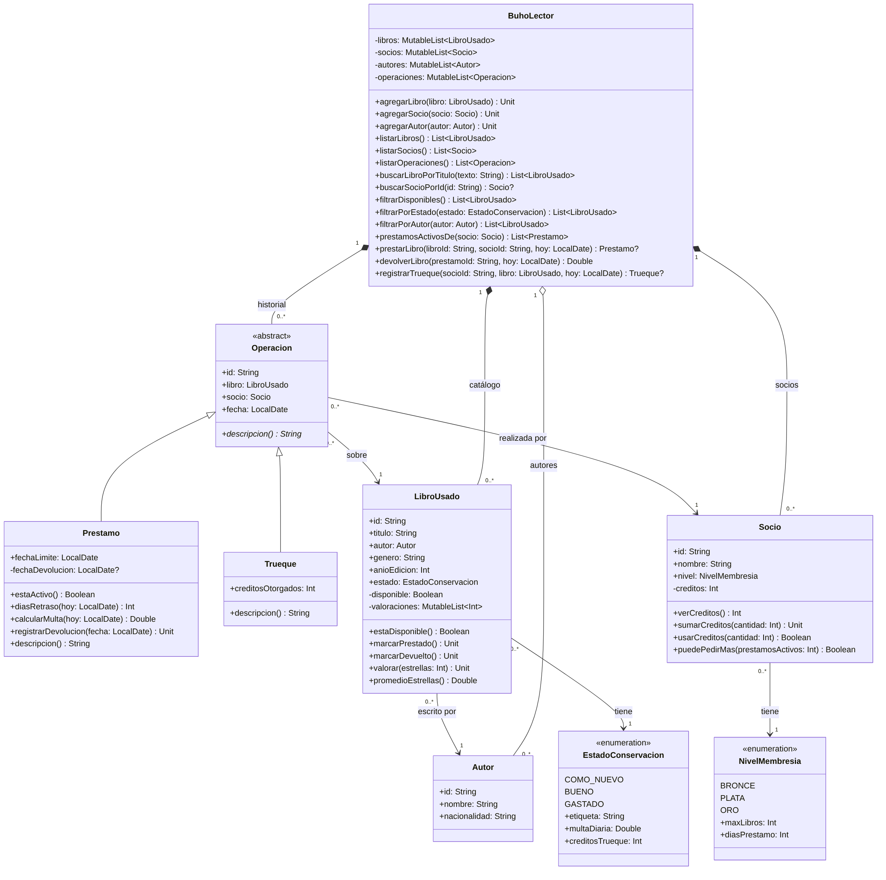
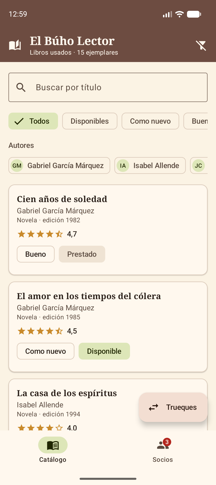
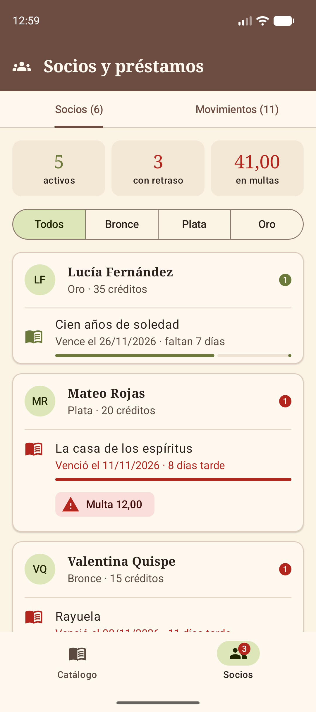

# 🦉 El Búho Lector

App Android de una librería de libros usados, hecha con **Kotlin**, **Jetpack Compose** y **Material 3**.
Proyecto del Primer Parcial de **Programación III**.

**Autora:** Adriana Milenka Torrico Cardoso

---

## Caso de estudio

**El Búho Lector** es una librería de **libros de segunda mano** que funciona con socios:

- **Préstamos:** el socio se lleva un libro hasta una fecha límite. Los días dependen de su nivel
  de membresía (Bronce, Plata u Oro). Si lo devuelve tarde, paga una multa por cada día de
  retraso. La multa diaria es mayor cuanto mejor conservado está el libro.
- **Trueques:** el socio entrega un libro usado a la tienda y recibe **créditos** según el estado
  del libro (Como nuevo = 30, Bueno = 20, Gastado = 10). Con esos créditos puede pagar multas.
- **Valoraciones:** los lectores califican los libros con 1 a 5 estrellas.

El diseño completo está en [docs/diseno_clases.md](docs/diseno_clases.md) y
[docs/diseno_pantallas.md](docs/diseno_pantallas.md).

---

## Diagrama de clases

---

## Clases

Paquete `com.example.examprimparcprogiii.model`:

| Clase | Tipo | Descripción |
|---|---|---|
| `Operacion` | Clase abstracta | Lo común a todo movimiento de un libro: id, libro, socio y fecha. Declara `descripcion()` como abstracto. |
| `Prestamo` | Hereda de `Operacion` | Fecha límite, días de retraso, multa y devolución. |
| `Trueque` | Hereda de `Operacion` | Créditos que recibe el socio por entregar un libro. |
| `LibroUsado` | Clase | Ejemplar físico. Su disponibilidad y sus valoraciones son privadas. |
| `Autor` | `data class` | Autor de los libros (asociación con `LibroUsado`). |
| `Socio` | Clase | Lector con nivel de membresía y créditos privados. |
| `EstadoConservacion` | `enum` | Como nuevo, Bueno o Gastado, con su multa diaria y sus créditos de trueque. |
| `NivelMembresia` | `enum` | Bronce, Plata u Oro, con el máximo de libros y los días de préstamo. |
| `BuhoLector` | Clase gestora | Listas privadas y métodos para agregar, listar, buscar, filtrar, prestar, devolver y registrar trueques. |
| `DatosPrueba` | `object` | Datos de ejemplo: 6 autores, 6 socios, 15 libros, 6 préstamos y 5 trueques. |

**Pilares de POO aplicados:**
- **Abstracción:** `Operacion` es abstracta y los enums modelan las categorías.
- **Encapsulamiento:** las listas, los créditos y la disponibilidad son `private` y solo cambian mediante métodos.
- **Herencia:** `Prestamo` y `Trueque` heredan de `Operacion`.
- **Polimorfismo:** cada hija sobrescribe `descripcion()` con `override`.

---

## Componentes de Jetpack Compose usados

Paquete `com.example.examprimparcprogiii.ui`:

| Componente | Dónde se usa |
|---|---|
| `Scaffold` | Esqueleto de las dos pantallas (aplica `innerPadding`) |
| `TopAppBar` | Barra superior marrón con título en serif |
| `NavigationBar` + `NavigationBarItem` | Cambio entre Catálogo y Socios con un estado, sin librería de navegación |
| `BadgedBox` + `Badge` | Número de préstamos con retraso y de préstamos activos por socio |
| `OutlinedTextField` | Búsqueda de libros por título |
| `FilterChip` | Filtros: Todos, Disponibles y estado de conservación |
| `InputChip` | Lista de autores, que filtra los libros por autor |
| `AssistChip` / `SuggestionChip` | Estado del libro, disponibilidad y multa |
| `LazyColumn` / `LazyRow` | Listas de libros, socios, movimientos y chips |
| `ElevatedCard` / `OutlinedCard` / `Card` | Tarjetas de libro, de socio y de resumen |
| `ListItem` | Filas de préstamos, movimientos y trueques |
| `ExtendedFloatingActionButton` | Botón "Trueques" |
| `ModalBottomSheet` | Hoja inferior con la lista de trueques |
| `PrimaryTabRow` + `Tab` | Pestañas Socios / Movimientos |
| `SingleChoiceSegmentedButtonRow` + `SegmentedButton` | Filtro por nivel de membresía |
| `LinearProgressIndicator` | Parte del plazo del préstamo que ya se usó |
| `HorizontalDivider` | Separadores entre filas |
| `Icon` / `IconButton` | Íconos con `contentDescription` |

---

## Capturas

| Pantalla 1 — Catálogo | Pantalla 2 — Socios |
|---|---|
|  |  |

---

## Cómo ejecutar

1. Abrir el proyecto en Android Studio.
2. Elegir un emulador con Android 8.0 (API 26) o superior.
3. Pulsar **Run ▶** (configuración `app`).
