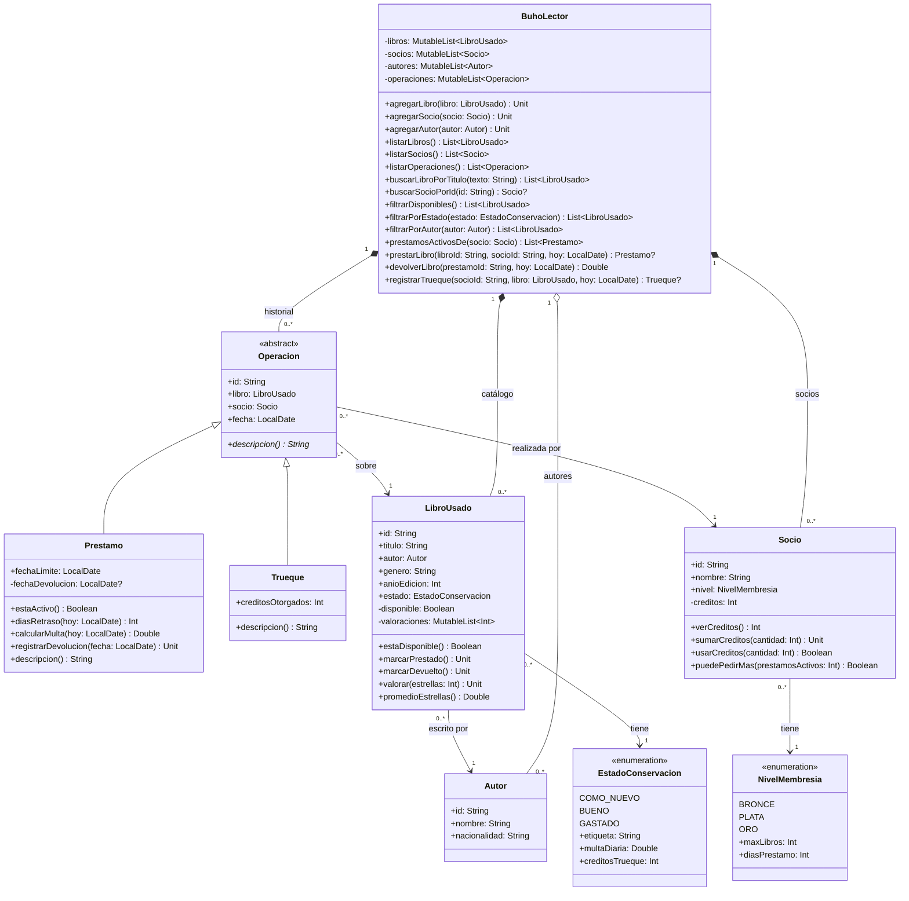

# El Búho Lector — Diseño de clases (Checkpoint 1)

**Caso de estudio:** librería de **libros usados** que hace **préstamos** con fecha límite y multa
por retraso, y **trueques** en los que el socio entrega un libro y recibe créditos según el estado
del libro. Los socios tienen un nivel de membresía y los libros reciben valoraciones de 1 a 5 estrellas.

**Paquete:** `com.example.examprimparcprogiii`

## Diagrama de clases

**Leyenda:** `+` público · `-` privado · `*` método abstracto · `<|--` herencia ·
`-->` asociación · `*--` composición · `o--` agregación.

## Reglas de negocio principales

- **Préstamo:** solo si el libro está disponible y el socio no superó `nivel.maxLibros`.
  La `fechaLimite` es `fecha + nivel.diasPrestamo`.
- **Multa:** `diasRetraso × estado.multaDiaria`. Un libro mejor conservado tiene una multa más alta.
- **Trueque:** el socio entrega un libro, que entra al catálogo como disponible, y recibe
  `estado.creditosTrueque` créditos (Como nuevo = 30, Bueno = 20, Gastado = 10).
  Los créditos se pueden usar para pagar multas.
- **Valoración:** `valorar()` solo acepta de 1 a 5 estrellas. `promedioEstrellas()` devuelve 0.0 si no hay valoraciones.

## Relaciones y pilares de POO

- **`Operacion` ← `Prestamo` / `Trueque` (herencia, multiplicidad 1 a 1):** la clase abstracta
  `Operacion` guarda lo común (id, libro, socio, fecha) y obliga a cada hija a escribir
  `descripcion()`. Se aplican **abstracción** (no se puede crear una "operación" genérica),
  **herencia** (las hijas reutilizan los atributos del padre) y **polimorfismo** (la gestora guarda
  una sola `List<Operacion>` y cada elemento responde `descripcion()` a su manera).
- **`Operacion` → `LibroUsado` y `Operacion` → `Socio` (asociación, 0..* a 1):** cada préstamo o
  trueque apunta a un solo libro y a un solo socio, y un mismo libro o socio puede aparecer en
  muchas operaciones a lo largo del tiempo. Pilar: **abstracción**, porque la operación modela el
  hecho real de "quién hizo qué con qué libro".
- **`LibroUsado` → `Autor` (asociación, 0..* a 1):** un autor escribe muchos libros y cada libro
  tiene un autor. El autor es un objeto propio, no un simple texto, por eso podemos filtrar con
  `filtrarPorAutor()`. Pilar: **abstracción** (cada concepto del mundo real es su propia clase).
- **`LibroUsado` → `EstadoConservacion` y `Socio` → `NivelMembresia` (asociación con enums, 0..* a 1):**
  las categorías son enums que llevan sus propias reglas (multa diaria, créditos, máximo de libros,
  días de préstamo). Pilares: **encapsulamiento**, porque cada regla vive en un solo lugar, y
  **abstracción**. Los atributos privados `disponible`, `valoraciones` y `creditos` solo se
  modifican mediante métodos que validan los datos.
- **`BuhoLector` ◆ libros, socios y operaciones (composición, 1 a 0..*) y ◇ autores (agregación):**
  la gestora es dueña de sus listas **privadas** y solo expone copias de solo lectura
  (`List`) y métodos para agregar, listar, buscar y filtrar. Pilar: **encapsulamiento**, porque desde
  fuera nadie puede borrar ni alterar las listas directamente. Los autores son una agregación
  porque un autor existe aunque la librería no tenga ninguno de sus libros.
